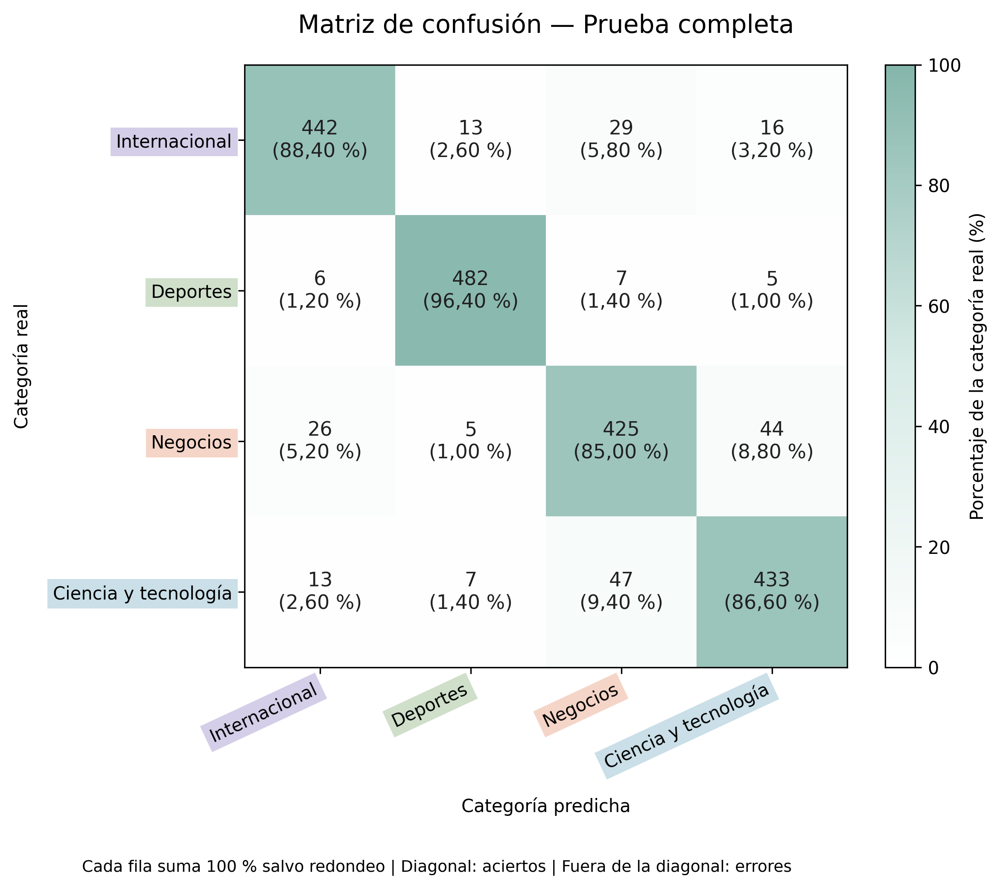

# Clasificación de noticias con TF-IDF

Proyecto de clasificación supervisada de noticias en inglés mediante preprocesamiento con spaCy, vectorización TF-IDF y regresión logística.

El trabajo corresponde a la preentrega 3 de Data Science III y reutiliza el corpus y las funciones de preprocesamiento del módulo 2.

## Objetivo

Construir un pipeline reproducible que transforme noticias en texto crudo en predicciones de cuatro categorías, compare configuraciones de TF-IDF y evalúe los resultados sin utilizar el conjunto de prueba para seleccionar el modelo.

## Organización del repositorio

- `data/ag_news/`: archivos originales de entrenamiento y prueba.
- `data/cargar_dataset.py`: script de carga provisto por la cátedra.
- `data/README_dataset.md`: documentación original del dataset.
- `notebooks/03_clasificador_tfidf_ag_news.ipynb`: desarrollo completo y resultados.
- `results/figures/`: matrices de confusión.
- `results/tables/`: experimentos, métricas, controles y predicciones.
- `results/resumen_experimento.json`: resumen de la configuración y los resultados.
- `requirements.txt`: dependencias y versiones utilizadas.

## Dataset y particiones

Se utiliza la muestra de AG News provista por la cátedra, con las columnas `text` y `label`.

| Conjunto | Noticias | Uso |
|---|---:|---|
| Entrenamiento interno | 6.400 | Ajuste de las configuraciones |
| Validación | 1.600 | Comparación y selección |
| Prueba | 2.000 | Evaluación final |

Las 8.000 noticias del archivo de entrenamiento se dividieron en entrenamiento interno y validación, manteniendo un 25 % de cada categoría: World, Sports, Business y Sci_Tech.

Se detectaron dos repeticiones adicionales después del preprocesamiento. Los textos equivalentes se agruparon antes de dividir los datos, evitando que aparecieran simultáneamente en entrenamiento interno y validación.

Una vez seleccionada la configuración, el pipeline se volvió a entrenar con las 8.000 noticias del archivo de entrenamiento.

## Preprocesamiento

Se reutilizaron las funciones `clean_text` y `preprocess_text` del módulo anterior:

1. Decodificación de entidades HTML y corrección de residuos como `#39;`.
2. Limpieza con expresiones regulares de etiquetas HTML, URLs y espacios repetidos.
3. Eliminación de atribuciones duplicadas de AP y del texto de navegación financiera `Quote, Profile, Research`.
4. Normalización a minúsculas.
5. Tokenización y lematización con el modelo de inglés `en_core_web_sm`.
6. Exclusión de puntuación aislada y tokens vacíos.

El notebook incluye ejemplos reales de antes y después y un control de preservación de la negación.

Las stop-words se filtran durante la vectorización. Se conservan `no`, `not`, `nor` y `never` para evitar eliminar negaciones.

## Modelo y vectorización

Se eligió **regresión logística** porque permite construir un baseline eficiente sobre matrices esparsas de texto y ofrece una referencia adecuada para clasificación multiclase.

Se mantuvo el mismo clasificador en todos los experimentos para comparar el efecto de los parámetros del vectorizador.

Parámetros del modelo:

- `C=1.0`
- `solver="lbfgs"`
- `max_iter=2000`
- `random_state=42`

Se evaluaron cuatro configuraciones de TF-IDF:

| max_features | ngram_range | Accuracy de validación | F1 macro de validación |
|---:|---|---:|---:|
| 5.000 | (1, 1) | 0,8756 | 0,8750 |
| 5.000 | (1, 2) | 0,8838 | 0,8833 |
| 10.000 | (1, 1) | 0,8806 | 0,8800 |
| 10.000 | (1, 2) | 0,8862 | 0,8857 |

`max_features` limita el número de características del vocabulario. `ngram_range=(1, 2)` incorpora palabras individuales y pares consecutivos de palabras, permitiendo representar contexto local.

El vectorizador utiliza `tokenizer=str.split`, `token_pattern=None` y `lowercase=False`, porque recibe texto previamente tokenizado, lematizado y normalizado.

La configuración seleccionada fue **10.000 características con unigramas y bigramas**, por obtener el mayor F1 macro en validación. La mejora fue moderada y corresponde a esta partición de los datos.

## Prevención de fuga de datos

El vectorizador y el clasificador se integraron en un `Pipeline` de scikit-learn.

Durante los experimentos, el vocabulario y las ponderaciones TF-IDF se ajustaron únicamente sobre entrenamiento interno. Validación se transformó con el vectorizador ya ajustado.

Después de seleccionar la configuración, se ajustó un nuevo pipeline sobre las 8.000 noticias de entrenamiento. El conjunto de prueba se utilizó únicamente para la evaluación final, sin ajustar el vocabulario ni seleccionar hiperparámetros.

## Resultados finales

| Evaluación | Noticias | Accuracy | F1 macro | F1 weighted |
|---|---:|---:|---:|---:|
| Prueba completa | 2.000 | 0,8910 | 0,8910 | 0,8910 |
| Prueba sin coincidencias con entrenamiento | 1.998 | 0,8909 | 0,8909 | 0,8909 |

En el conjunto de prueba completo se obtuvieron **1.782 predicciones correctas y 218 incorrectas**.

Después del preprocesamiento se identificaron dos noticias de prueba equivalentes a noticias de entrenamiento. Las diferencias originales correspondían a atribuciones de la agencia AP y las etiquetas coincidían.

Se conservaron los archivos originales y se reportó una evaluación complementaria excluyendo esas dos noticias. La diferencia entre ambas evaluaciones fue mínima; las coincidencias quedan documentadas como una limitación del conjunto de prueba.

### Resultados por categoría — Prueba completa

| Categoría | Precision | Recall | F1-score | Noticias |
|---|---:|---:|---:|---:|
| World | 0,9076 | 0,8840 | 0,8956 | 500 |
| Sports | 0,9507 | 0,9640 | 0,9573 | 500 |
| Business | 0,8366 | 0,8500 | 0,8433 | 500 |
| Sci_Tech | 0,8695 | 0,8660 | 0,8677 | 500 |



Cada fila representa la categoría real y suma 100 %, salvo redondeo. La diagonal muestra los aciertos y las demás celdas muestran los errores.

### Interpretación de los errores

Sports obtuvo el mayor F1-score y Business presentó el menor.

La confusión más frecuente ocurrió entre Business y Sci_Tech: 47 noticias de ciencia y tecnología se clasificaron como negocios y 44 noticias de negocios se clasificaron como ciencia y tecnología. Estas confusiones reúnen 91 de los 218 errores, equivalentes al 41,74 %.

Los ejemplos revisados en validación muestran noticias que combinan empresas, precios, software y tecnología. Este solapamiento temático ayuda a interpretar la dificultad, aunque no demuestra por sí solo qué términos determinaron cada predicción.

## Cómo ejecutar el proyecto

El notebook está preparado para Google Colab.

1. Abrí el notebook desde el siguiente enlace.
2. Para reproducir las dependencias registradas, ejecutá la celda de instalación indicada debajo antes de las celdas del proyecto.
3. Si Colab solicita reiniciar la sesión después de instalar, reiniciala.
4. Ejecutá las celdas del notebook en orden.

[Abrir notebook en Google Colab](https://colab.research.google.com/github/martingnegro/ag-news-text-classification/blob/main/notebooks/03_clasificador_tfidf_ag_news.ipynb)

Celda de instalación:

```python
%pip install -r https://raw.githubusercontent.com/martingnegro/ag-news-text-classification/main/requirements.txt
```

Los datos y el script de carga se descargan directamente del repositorio público. No se necesita cargar archivos manualmente ni conectar Google Drive.

El notebook guarda los resultados en `/content/ag-news-text-classification/results/` y permite descargarlos en un archivo ZIP. Esa ubicación pertenece a la sesión temporal de Colab.

## Entorno utilizado

- Python: 3.13.18
- NumPy: 2.1.3
- pandas: 2.2.3
- scikit-learn: 1.6.1
- Matplotlib: 3.10.0
- spaCy: 3.8.18
- tqdm: 4.67.3
- Modelo `en_core_web_sm`: 3.8.0

Las dependencias están registradas en `requirements.txt`. La partición utiliza la semilla 42; los tiempos de ejecución pueden variar según el entorno.

## Conclusión

El pipeline obtuvo un F1 macro de 0,8910 en prueba y de 0,8909 al excluir coincidencias con entrenamiento, con mayor dificultad para distinguir noticias de negocios y tecnología, y constituye una referencia para comparar los modelos del próximo módulo.
